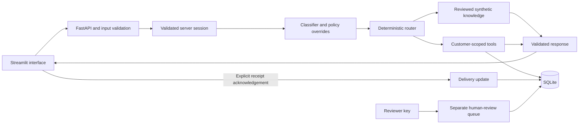

# SupportDesk AI

**Українською:** [пояснення всіх 40 основних рішень](docs/DECISIONS_UK.md).

A working AI-assisted customer-support portfolio demo with authenticated account tools, reviewed synthetic help content, deterministic policy routing, and a human-review queue.

**Independent educational project. Not an official Nebula or OBRIO product. All customers, transactions, and support policies are synthetic.** The public account selector is a login simulator, so run this locally and do not connect real customer data.

## Run the demonstration

From this project folder, with Python 3.11 or newer:

```bash
python -m venv .venv
source .venv/bin/activate
python -m pip install -r requirements.txt
python scripts/run_demo.py
```

On Windows, activate with `.venv\Scripts\activate` instead. Open [the customer interface](http://127.0.0.1:8501). The [interactive API explorer](http://127.0.0.1:8000/docs) is also available. Press **Ctrl+C** in the terminal to stop both services.

The default `mock` provider works without credentials or network access. A SQLite database is seeded on first startup at `data/support.db`. Startup preserves existing tickets and demo data.

For the exact dependency versions used during verification, install `requirements-lock.txt` instead of the broad runtime requirements. See [verification evidence](docs/VERIFICATION.md) for the tested environment and limits.

If you prefer separate terminals:

```bash
python -m uvicorn app.main:app --host 127.0.0.1 --port 8000 --no-access-log
```

```bash
python -m streamlit run ui/streamlit_app.py --server.address 127.0.0.1 --server.port 8501
```

Run both from the project folder. `API_URL` can point the interface at another local backend; its default is `http://127.0.0.1:8000`. Both launch methods bind to loopback. The launcher checks that ports 8000 and 8501 are available before starting.

## Try these scenarios

| Step | What to do | What it demonstrates |
|---|---|---|
| 1 | Stay in Guest and ask “How do I protect my privacy?” | Public help with synthetic source evidence |
| 2 | As Guest, ask “Show my billing history” | Private records require a customer session |
| 3 | Select Alex; ask “Show my billing history” | Only Alex's synthetic transactions are returned |
| 4 | Ask “I want a refund for tx_alex_001” | Verified transaction linkage and an open human-review ticket; no refund execution |
| 5 | Click **Mark as received** after reading the reply | Explicit receipt acknowledgement, separate from resolution |
| 6 | Switch to Blair; ask “How do I cancel?” | Old chat/account state is cleared; guidance follows Blair's App Store channel |
| 7 | Ask “Show my subscription status and billing history” | Ambiguous private operations ask for clarification |

The sidebar also accepts an optional transaction ID and an explicit human-support request. The collapsed **How this answer was handled** panel explains intent, tool, route, and fallback. It excludes session/receipt secrets and private record payloads.

Use [the timed interview script](docs/DEMO_SCRIPT.md) for a three-to-five-minute walkthrough.

## Optional human-review interface

By default, the reviewer API is disabled. To enable it, set a nonempty, strong `REVIEWER_API_KEY` in the backend's environment **before** starting the application. Open **Human Review** in the Streamlit navigation, enter that same key in the password field, and click **Unlock review queue**.

The page does not read or automatically fill the key from environment variables. Customer selection does not grant reviewer access. It shows up to 100 recent tickets: customer reference, category, redacted description, linked transaction reference, status, time, and escalation reason. **Lock review queue** clears its key and cached tickets. The customer page continues to show only that customer's own ticket history.

This is a minimal review queue, not a real helpdesk integration. No agent notification, refund, ticket assignment, reply, or closure is performed. The shared reviewer key is a demo limitation; a production service needs real staff identity and scoped permissions.

## Optional real LLM

The real adapter calls an OpenAI-compatible `/chat/completions` endpoint and requests JSON output. Supply a model supported by your provider; no model is silently selected for you.

```bash
export LLM_PROVIDER=openai_compatible
export LLM_BASE_URL=https://api.openai.com/v1
export LLM_MODEL='your-json-mode-compatible-model'
read -s -p 'LLM API key: ' LLM_API_KEY
export LLM_API_KEY
python scripts/run_demo.py
```

For a compatible local model server, set `LLM_BASE_URL` to its local API base and `LLM_MODEL` to its served model name. Leave `LLM_API_KEY` unset only if that server does not require it. The endpoint must support Chat Completions, `response_format: {"type":"json_object"}`, and the request parameters used in `app/intelligence.py`. Compatibility must be checked with the selected server/model.

The model classifies the request and may select retrieved public article IDs. Backend code still controls authorization, ticket creation, financial escalation, and final policy text. Private retrieved account records are never sent to the model. Free-text user messages receive best-effort redaction, which is not comprehensive DLP.

Malformed output, unsupported responses, rate limits, timeouts, and transport failures have deterministic fallbacks. A fallback response **does not prove that the configured model succeeded**; inspect the classification source and fallback reason. Automated tests verify the provider transport contract with mocks. A live external-model inference was not verified without supplied credentials or a running compatible local model.

## Configuration

The application reads environment variables. **`.env.example` is documentation; the app does not auto-load `.env` files.** Export variables or configure them in your process environment.

| Variable | Default | Purpose |
|---|---|---|
| `LLM_PROVIDER` | `mock` | `mock` or `openai_compatible` |
| `LLM_BASE_URL` | `https://api.openai.com/v1` | Provider API base; `/chat/completions` is appended |
| `LLM_MODEL` | Empty | Required explicitly for real-provider mode |
| `LLM_API_KEY` | Empty | Backend-only provider credential |
| `LLM_TIMEOUT_SECONDS` | `8` | Per-operation provider timeout; maximum 30 seconds |
| `LLM_MAX_ATTEMPTS` | `2` | Model attempt limit, from 1 to 3 |
| `DATABASE_PATH` | `data/support.db` under the project | SQLite storage path |
| `SESSION_TTL_SECONDS` | `3600` | Demo-session lifetime |
| `REVIEWER_API_KEY` | Empty | Empty disables reviewer endpoints |
| `API_URL` | `http://127.0.0.1:8000` | Backend address used by Streamlit |

A public-answer request can make separate classification and article-selection calls. Timeout and retry budgets therefore apply more than once. The UI uses a 200-second socket timeout to allow configured inference attempts; neither this nor the provider's socket timeouts is a strict whole-request deadline. The default mock path makes no model network calls.

## Project structure

```text
app/
  main.py              HTTP routes, validation/error handling, request logging
  config.py            Environment configuration
  auth.py              Demo sessions and reviewer authorization
  models.py            Validated request/response and intent contracts
  db.py                SQLite schema, transactions, synthetic seed data
  intelligence.py      Rule classifier, real provider, validation, fallbacks
  knowledge.py         Auditable lexical retrieval
  privacy.py           Best-effort redaction
  tools.py             Customer-scoped tools, tickets, receipts
  service.py           Deterministic support workflow
  observability.py     Structured request logs and in-process counters
ui/
  streamlit_app.py      Customer chat and account interface
  pages/1_Human_Review.py  Explicitly unlocked reviewer queue
data/                 Synthetic knowledge and evaluation cases; runtime DB
scripts/
  run_demo.py          Starts/stops the two local services
  evaluate.py          Synthetic intent/retrieval evaluation
tests/                API, isolation, failure, provider, and interface tests
docs/                 Architecture, decisions, demo script, verification
```

## Architecture



See [architecture and trust boundaries](docs/ARCHITECTURE.md) and [the complete decision guide](docs/DECISIONS.md).

## Example API workflow

This runnable example uses the `httpx` dependency already installed with the application. Start the backend first, then run the following in Python from the project folder. Session and receipt secrets are deliberately not printed.

```python
from uuid import uuid4
import httpx

with httpx.Client(base_url="http://127.0.0.1:8000", timeout=30) as client:
    login = client.post("/demo/sessions", json={"persona": "alex"})
    login.raise_for_status()
    client.headers["Authorization"] = "Bearer " + login.json()["access_token"]

    history = client.get("/me/transactions")
    history.raise_for_status()
    print(history.json())  # Only Alex's synthetic transactions

    event = {
        "event_id": str(uuid4()),
        "message": "I want a refund for tx_alex_001",
        "transaction_id": "tx_alex_001",
    }
    result = client.post("/chat", json=event)
    result.raise_for_status()
    response = result.json()
    print({k: response[k] for k in ("intent", "case_status", "delivery_status")})
    print(response["ticket"]["id"])

    retry = client.post("/chat", json=event)
    retry.raise_for_status()
    assert retry.json()["ticket"]["id"] == response["ticket"]["id"]
    assert retry.json()["data"]["deduplicated"] is True

    receipt = client.post(
        f"/responses/{response['response_id']}/ack",
        json={"receipt_token": response["receipt_token"]},
    )
    receipt.raise_for_status()
    print(receipt.json()["delivery_status"])
    client.delete("/demo/sessions").raise_for_status()
```

The printed response-state subset is:

```json
{
  "intent": "REFUND_REQUEST",
  "case_status": "escalated",
  "delivery_status": "generated"
}
```

The last printed value is `delivered`, after the explicit acknowledgement. There is no `resolved` transition. Reusing an event ID with changed ticket details returns `409`; a new event ID is a new submission.

Important endpoints:

| Endpoint | Access | Purpose |
|---|---|---|
| `GET /health`, `GET /articles` | Public | Local health and public knowledge retrieval |
| `GET /demo/personas`, `POST /demo/sessions` | Public demo only | Choose a synthetic identity |
| `DELETE /demo/sessions` | Current session | Revoke the token |
| `POST /chat` | Public or demo session; private routes require a customer | Classify, route, answer, or escalate |
| `GET /me/subscription`, `/me/transactions`, `/me/tickets` | Customer session | Read only the current customer's records |
| `POST /tickets` | Customer session | Create an idempotent support ticket |
| `POST /responses/{response_id}/ack` | Matching session and receipt secret | Record explicit delivery acknowledgement |
| `GET /review/tickets`, `/review/metrics` | `X-Reviewer-Key`; disabled by default | Minimal review queue and process-level metrics |

## Tests and evaluation

```bash
python -m pip install -r requirements-dev.txt
python -m pytest -q
python -m ruff check .
python scripts/evaluate.py
```

The evaluation defaults to mock mode even if real-provider environment variables are set. To intentionally test the configured provider, use `python scripts/evaluate.py --configured-provider`; that may make paid or local-model calls. `--output report.json` writes the detailed evaluation report to a chosen file.

The current synthetic evaluation has 40 English intent examples and 13 retrieval-labeled examples. The deterministic classifier matches 38/40 expected intents, and retrieval includes the expected article in the top three on 13/13 examples. The two difficult paraphrases are intentionally retained to show limitations. These examples were developed with the rules and are not held out; the scores are **not production accuracy or a guarantee of answer quality**. Full verification results and remaining limits are in [VERIFICATION.md](docs/VERIFICATION.md).

## Important limits

- Public persona selection is not real identity. Bind locally and use synthetic data.
- Regex redaction is incomplete. Private account rows are kept out of model prompts, but free text can still contain sensitive information.
- Financial tools are read-only. Tickets do not execute refunds, cancel subscriptions, notify a real agent, or resolve cases.
- SQLite, shared reviewer keys, local token storage, and process-local counters are demonstration choices. There is no production rate limiting, retention program, staff identity, backup process, or durable metrics service.
- Ticket idempotency is per customer and event UUID, not semantic deduplication or universal exactly-once processing. A new UUID can create another ticket with the same text.
- The classifier is English-focused and the knowledge base is small. A valid, high-confidence intent can still be wrong.
- Model fallbacks, synthetic evaluation, and mocked provider tests do not establish real-provider availability or production readiness.

Read [the decision guide](docs/DECISIONS.md) for the reason, alternative, cost, code pointers, and production changes behind each important choice. [PORTFOLIO.md](docs/PORTFOLIO.md) contains reusable project copy and interview talking points.

## API reference used

The configurable adapter follows the documented Chat Completions message and JSON-response interface: [official OpenAI Chat API reference](https://developers.openai.com/api/reference/resources/chat). Provider compatibility and a live inference must still be verified for the model you configure.
