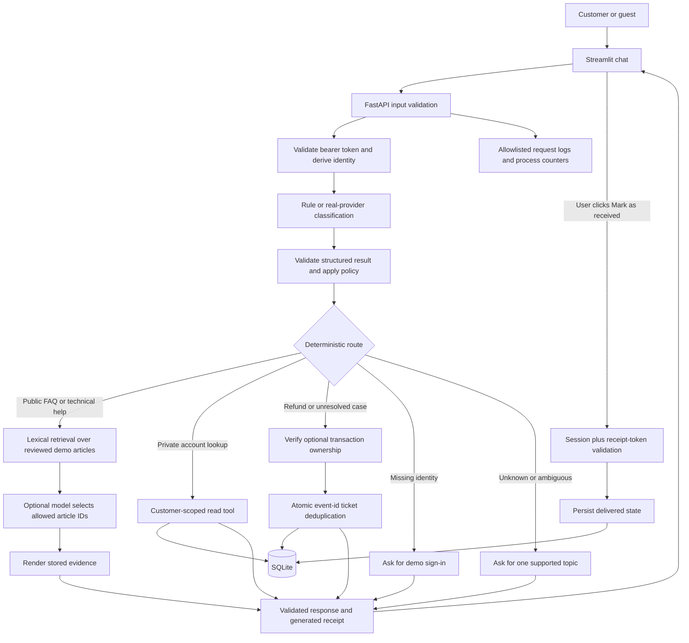
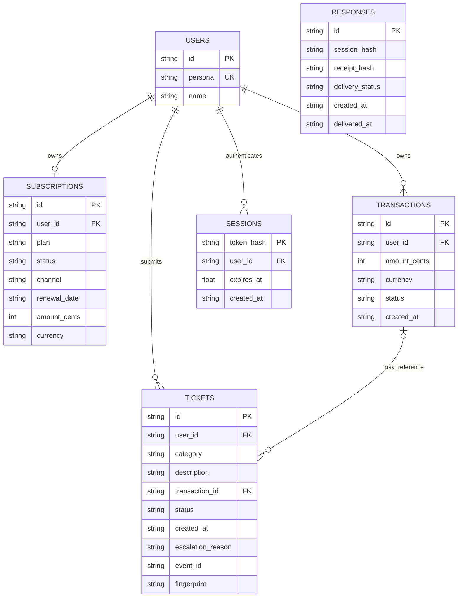

# Architecture and trust boundaries

SupportDesk AI is a local, single-backend support workflow. The Streamlit interface is an HTTP client. FastAPI owns validation, identity, routing, tools, and persisted state. SQLite holds synthetic account and workflow data. The optional model is an untrusted inference dependency with no database connection or arbitrary tool execution.

## Request flow



A routine cancellation follows the known subscription channel and returns instructions. A guest receives public channel choices. If an authenticated customer's purchase channel is missing or unsupported, or the standard process fails, the workflow can create a human-review ticket. No cancellation is executed.

## Who controls each value?

| Value or decision | Trusted source | Never trusted for this purpose |
|---|---|---|
| Current customer | Validated server-issued session | Chat text, LLM output, arbitrary `user_id` JSON |
| Tool allowed for a route | Backend policy code | Model-proposed executable code or SQL |
| Transaction ownership | Database query scoped to authenticated customer | A transaction ID's format or presence in chat |
| Refund/cancellation execution | Not implemented | Assistant statements or ticket creation |
| Ticket status and escalation reason | Backend-defined values | Caller-supplied status or model prose |
| Public policy answer | Reviewed local synthetic articles | Invented or unsupported model claims |
| Delivery state | Matching session and explicit receipt acknowledgement | Successful text generation |
| Reviewer access | Separate configured key | Customer selector, customer token, frontend-only state |

A valid transaction ID is merely an identifier. An opaque session token is a credential. Both require server-side checks before they authorize a read or write.

## Data model



Guest sessions have no customer foreign key. `RESPONSES.session_hash` binds a receipt to a session but is not a foreign key that prevents session revocation. Tickets enforce uniqueness on `(user_id, event_id)`. IDs are not access credentials; authorization is separate.

Private record queries use `WHERE user_id = ?` and parameters supplied from `AuthContext`. Ticket creation checks transaction ownership inside the same short write transaction used for deduplication and insertion. SQLite foreign keys, WAL mode, and short connection lifetimes support this local workflow; they do not make it a distributed data system.

## Retry and delivery sequence

```mermaid
sequenceDiagram
    participant U as Streamlit
    participant A as FastAPI
    participant D as SQLite
    U->>A: Refund request, bearer token, event E
    A->>D: Verify ownership; create ticket for customer plus E
    D-->>A: Ticket T
    A--xU: Response lost in transport
    U->>A: Retry same event E and same payload
    A->>D: Look up customer plus E and compare fingerprint
    D-->>A: Existing ticket T
    A-->>U: Ticket T, deduplicated=true, generated receipt
    Note over U: Render the response
    U->>A: Explicit acknowledgement with response ID and receipt secret
    A->>D: Verify same session and receipt hash; mark delivered
    A-->>U: delivered
    Note over U,D: No step marks the problem resolved or executes a refund
```

Deduplication covers ticket events. Chat responses are not fully replayed: a retry may generate another response ID and receipt. New UUIDs are different events even if their text is identical. An event ID reused with changed ticket fields returns `409`.

## Failure behavior

| Failure | Implemented behavior |
|---|---|
| No session on a public question | Public help remains available |
| No customer identity on a private route | Ask for demo sign-in; no private read |
| Invalid, revoked, or expired bearer token | `401`; UI clears private state |
| Cross-account or nonexistent transaction linkage | Generic not-found response; no linked ticket |
| Invalid model JSON/types/schema | Deterministic fallback with sanitized diagnostic reason |
| Low model confidence | Deterministic fallback; no permission change |
| Model timeout, network fault, `429`, or `5xx` | Bounded retry/backoff, then fallback |
| Provider `4xx` such as unsupported JSON mode | No pointless retry; deterministic fallback |
| No relevant evidence | Clarification or human-support guidance; no invented policy |
| SQLite error | Sanitized `503`; same event may be retried |
| Response lost after ticket insertion | UI retains original event/payload; retry reuses ticket |
| Backend unreachable | UI shows a recoverable setup/retry message |
| Reviewer key missing/incorrect | Review disabled/denied; no customer-token bypass |
| Wrong receipt secret or different session | Receipt not found; no delivery state change |

## Observability and deployment boundaries

`app/observability.py` logs allowlisted request ID, route template, status, and elapsed time. It keeps process-local request totals, mean/max request latency, intent/case counts, fallback counts, ticket creation/reuse, and database-error counts. The reviewer-protected `/review/metrics` endpoint exposes the aggregate snapshot. Counters reset when the backend process restarts; they are not durable business analytics or latency percentiles.

Default Uvicorn access logs are disabled by the documented launcher/commands to avoid query-string logging. Request validation errors omit echoed raw input. Tokens, free-text messages, retrieved account records, and provider response bodies are not intended log fields.

All services bind to loopback for the demo. No external helpdesk, payment platform, public hosting, or real identity provider is connected. See [DECISIONS.md](DECISIONS.md) for the production changes and [VERIFICATION.md](VERIFICATION.md) for what was actually exercised.
