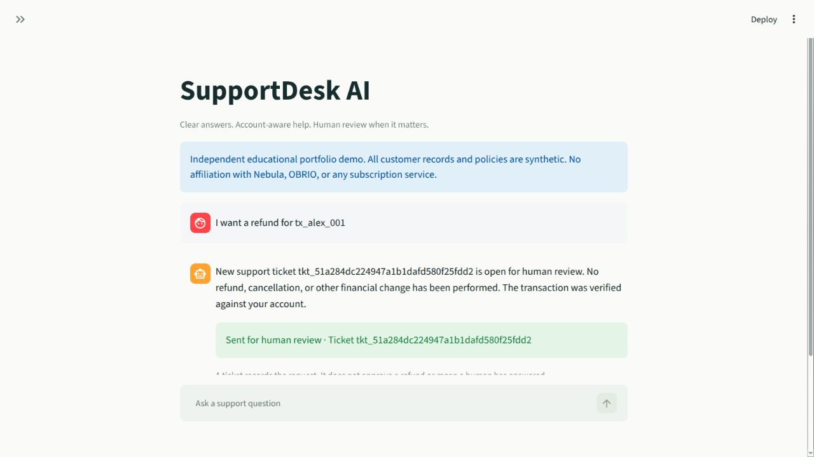
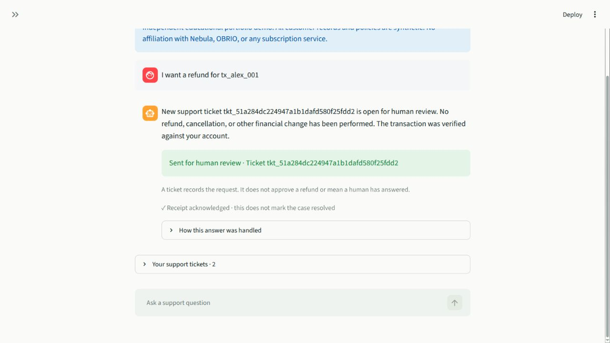

# Verification record

Verified on 19 October 2026 (Europe/Kyiv), using Python 3.12.3 on Linux. This records checks actually executed; it is not a production-readiness claim.

## Results

| Area | Result | Evidence |
|---|---|---|
| Complete automated suite | **102 passed** in 5.94 seconds | [Saved pytest output](test-results.txt) |
| API, authorization and persistence | 46 passing cases | `tests/test_api.py` |
| Classification, retrieval and provider contract | 50 passing cases | `tests/test_intelligence.py` |
| Streamlit interaction/state behavior | 6 passing tests using mocked HTTP | `tests/test_ui.py` |
| Static checks | Ruff lint passed; project format checks passed | `python -m ruff check .`; `python -m ruff format --check .` |
| Python compilation | Passed for application, UI, scripts and tests | `python -m compileall -q app ui scripts tests` |
| Synthetic intent evaluation | 38/40 expected intents | [Detailed evaluation](evaluation-results.json) |
| Synthetic retrieval evaluation | 13/13 expected articles present in top 3 | [Detailed evaluation](evaluation-results.json) |
| Documented API example | Executed successfully against local mock-mode server | [Example output](example-output.txt) |
| Real hosted/local model inference | **Not verified**: no credentials or compatible local model supplied | See provider boundary below |

Local virtual-environment paths in the saved pytest output are normalized to `.venv`. The test run emits one Starlette deprecation warning about its HTTPX test-client integration. It does not fail a test. The tested dependency versions, including development tools, are captured in `requirements-lock.txt`; this is a version snapshot, not a hash-verified supply-chain lock. Cross-platform installs and Python versions other than 3.12.3 were not executed.

## Stage checks

1. **Persistence and identity:** initialized a temporary database; verified three personas, three subscription channels, two scoped transactions per account, session issuance, and denial of unauthenticated private access.
2. **Classification and routing:** exercised public knowledge, scoped account lookups, malformed structured output, conservative ambiguity handling, and the boundary that recomputes authentication requirements independently of model flags.
3. **Escalation and interface:** verified refunds, known-channel cancellation guidance, missing/unsupported-channel escalation, customer ticket privacy, concurrent duplicate submissions, explicit acknowledgement, interface account switching, session expiry, retry event preservation, and reviewer unlock/lock behavior.
4. **Final checks:** ran the complete suite, lint, format check, compilation, synthetic evaluation and documented API example. Inspected the actual running Streamlit customer interface in the in-app browser.

The initial sandbox runtime could not wake the test framework's worker thread. The same tests passed in the authorized local runtime outside that sandbox. No application workaround was introduced for this execution-environment restriction.

## Browser observations

The actual local UI was exercised in mock mode:

- A guest received the stored privacy article with its source label.
- Selecting Alex replaced guest state with Alex's synthetic subscription.
- Billing requests went through the running API.
- A refund request linked `tx_alex_001` only after account ownership verification and displayed an open review ticket.
- Clicking **Mark as received** changed the displayed receipt state to acknowledged while explicitly leaving the case unresolved.
- The optional Human Review page was checked for its locked view; enabled reviewer behavior is covered by API and Streamlit tests.

These screenshots contain synthetic data only. The live workspace database may contain tickets created while demonstrating the UI; the downloadable source archive excludes runtime databases and sessions and seeds fresh data on first launch.

## What the tests prove—and what they do not

Cross-user tests manipulate both chat text and structured payloads, attempt foreign transaction links, and try incorrect receipt/session combinations. They verify the implemented ownership checks; they are not a complete penetration test or proof against every possible attack.

Failure tests inject invalid JSON, invalid schemas, timeouts, rate limits, and database errors. A dedicated regression commits a ticket, simulates failure while recording the response, then retries the same event and checks that only one ticket exists. These tests establish local event idempotency, not exactly-once behavior in a real external helpdesk.

Provider tests exercise the actual adapter with controlled HTTP transports, including retry counts and fallback reasons. They do not establish availability, model quality, account permissions, billing, or compatibility with a particular deployed model. In real mode, a request can fall back successfully even when the provider never succeeded; inspect `classification_source` and `fallback_reason`.

The 40-example dataset is synthetic, English-focused, hand-authored and developed with the rules. It is not held out. The two retained misses—“everything I was billed last month” and “stop future deductions”—return `UNKNOWN`, showing the conservative classifier's limited paraphrase coverage. Retrieval hit@3 measures candidate inclusion, not answer relevance or completeness. No production accuracy, customer satisfaction, cost savings or workload reduction has been measured.
